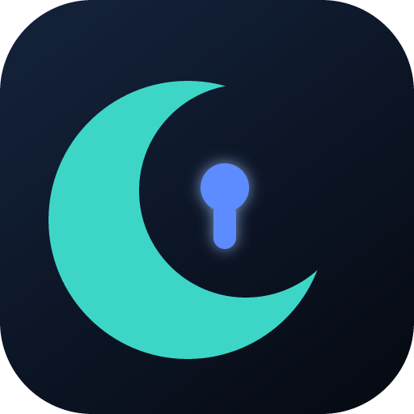

<p align="center">
  
</p>

# Caretaker

[](https://github.com/TRU5T/caretaker/actions/workflows/ci.yml)
[](LICENSE)
[-2ea44f)](SAFETY.md)

Self-hosted **Moonlight / Apollo companion** for a Windows gaming PC. From your phone on the couch:

1. **Wake** the PC (Wake-on-LAN)
2. **Unlock** the Windows lock screen (PIN pad)
3. Open **Moonlight** and stream via **Apollo**
4. **Sleep** the PC when you are done

Caretaker stops at “Ready”. It does not replace Moonlight or Apollo.

> **Is this safe?** Caretaker is **not malware** — no phone-home, no file theft, no remote shell. It **is** a privileged LAN tool: if someone can open your Hub, they can wake, unlock, and sleep the PC. Antivirus may flag the unsigned Windows agent because it injects input on the lock screen (that is expected). Full write-up: **[SAFETY.md](SAFETY.md)**. Do not expose the Hub to the public internet.

```
Phone / browser  →  Caretaker Hub (Docker)  →  WoL magic packet
                              ↕ bearer token (HTTP on LAN)
                    Caretaker Agent (Windows service)
                              ↕
                    Apollo + your games
```

## Components

| Piece | Path | Runs where |
|--------|------|------------|
| **Hub** | [`hub/`](hub/) | Always-on host (NAS, Pi, homelab VM) in Docker |
| **Agent** | [`agent/`](agent/) | Native Windows service on the gaming PC |
| **Shared contract** | [`shared/api.ts`](shared/api.ts) | API shapes |

Apollo has no host WoL / sleep / unlock API, which is why this exists.

## Requirements

- A Windows 10/11 gaming PC with Apollo (or Sunshine) and Moonlight on the client
- An always-on Linux box on the **same LAN** for the Hub (Docker). Docker Desktop on macOS/Windows is a poor WoL host — UDP broadcast usually never leaves the VM.
- Go 1.22+ only if you build the agent yourself (the Hub image already compiles the Windows installer)
- Node 18+ only if you run the Hub outside Docker

**Ports**

| Port | Proto | Role |
|------|-------|------|
| 8080 | TCP | Hub UI + API |
| 7842 | TCP | Agent HTTP |
| 7843 | UDP | Unpaired agent LAN beacon |

## Quick start

### 1. Hub (container)

**Unraid (recommended on a NAS):** see **[`unraid/README.md`](unraid/README.md)** — drop in the template, use host networking, image `ghcr.io/tru5t/caretaker-hub:latest`.

**Docker Compose** (any Linux host):

```bash
cd hub
export CARETAKER_UI_PASSWORD='pick-a-strong-password'
export CARETAKER_SESSION_SECRET="$(openssl rand -hex 32)"
docker compose up -d --build
```

Open `http://<hub-host>:8080`. If you skip the env vars, the password is `changeme` — change it immediately.

`network_mode: host` is required so Wake-on-LAN broadcasts reach your LAN. Details: [`hub/README.md`](hub/README.md).

### 2. Agent (Windows gaming PC)

On the **gaming PC**, open the Hub → **Setup** → **Download installer**. Double-click `caretaker-agent-setup.exe` and accept the administrator prompt. The installer copies the agent to Program Files, starts the **Caretaker Agent** service, and opens a Windows Firewall rule for the LAN.

Then tap **Pair** when the PC appears under **Nearby PCs**.

That installer is the agent from **this repo**, compiled when you built the Hub image. Windows will likely SmartScreen it (unsigned). More info → Run anyway. Details: [SAFETY.md](SAFETY.md), [`agent/README.md`](agent/README.md).

The unpaired agent broadcasts on UDP **7843**. Pair it promptly; until then, anyone on the LAN who can reach TCP **7842** can pair. After pairing, sleep/unlock require the Hub’s bearer token.

**Fallback (Command Prompt):** Setup → add the PC manually → run `caretaker-agent pair --hub … --code … --agent-url …`. Or build with `bash agent/build-windows.sh` / `go build` and `caretaker-agent.exe install`.

### 3. Couch flow

1. Open Caretaker on your phone (same LAN, or VPN into it)
2. **Wake** → wait until status is **locked** or **ready**
3. If locked, enter PIN
4. When status is **ready** (Apollo badge up), open Moonlight
5. **Sleep** when finished

## Wake-on-LAN checklist (Windows host)

1. **UEFI/BIOS:** enable Wake on LAN / Power on by PCI-E
2. **Device Manager → NIC → Power Management:** allow this device to wake the computer
3. **NIC Advanced:** enable **Wake on Magic Packet**; disable **Wake on pattern**
4. Prefer **Sleep** over full shutdown if your NIC drops WoL after long soft-offs
5. Hub and PC must be on the **same L2 network** (or a directed broadcast your router allows)

## Security (summary)

Full model, AV notes, and “I didn’t install this” steps: **[SAFETY.md](SAFETY.md)**. Report vulnerabilities per **[SECURITY.md](SECURITY.md)**.

- Hub UI is password-protected (session cookie)
- Hub ↔ agent uses a **shared bearer token** after pairing
- Unlock PIN/password is **never stored on the hub** and is not logged (only length)
- Unlock attempts are rate-limited (3 failures / 15 minutes) so a bad PIN does not lock Windows
- **LAN-first:** HTTP, not HTTPS. Put a VPN (Tailscale, WireGuard) in front if you leave the house. Do not port-forward the Hub or agent.
- For reliable unlock, run the agent as a **Windows service** (SYSTEM) so it can reach the secure desktop

<details>
<summary>How remote unlock works (do not “simplify” this)</summary>

This sequence was arrived at empirically and is the only one that unlocks on the first attempt. Code: `wakeCredentialUI` / `unlockInject` in `agent/internal/agent/session_windows.go`.

1. The service (Session 0) duplicates the **winlogon SYSTEM token** for the active console session and launches itself as `unlock-helper` there via `CreateProcessAsUserW`, hidden (`CREATE_NO_WINDOW` + `SW_HIDE`).
2. The helper joins `winsta0`, then wakes the monitor with `SetThreadExecutionState(ES_DISPLAY_REQUIRED)`. This needs no desktop access, so it works while `SendInput` is still being denied.
3. It taps **Space** (not a modifier — the Win10/11 lock screen is `LockApp` on the **Default** desktop and ignores Shift), re-tapping every 500 ms until `OpenInputDesktop` reports **Winlogon**, which is the desktop that owns the password field. `SendInput` is only accepted by the desktop currently owning input, and that desktop changes as a result of the tap.
4. It re-attaches to that desktop, clears the field (Ctrl+A, Backspace), types the secret, then presses Enter.

If typing is interrupted part-way (the desktop switched mid-word), the field is cleared and the whole secret is retyped — never resumed, since a partial secret would submit a wrong password and burn a Windows lockout attempt.

</details>

## Development

See [CONTRIBUTING.md](CONTRIBUTING.md).

```bash
# Hub
cd hub && npm install && CARETAKER_DATA=../data npm run dev

# Agent (Linux stub — sleep/unlock are Windows-only)
cd agent && go run ./cmd/caretaker-agent run --config /tmp/caretaker-agent.json
```

Cross-compile Windows agent from Linux:

```bash
bash agent/build-windows.sh
```

## API sketch

Hub (`:8080`):

| Method | Path | Auth | Purpose |
|--------|------|------|---------|
| POST | `/api/login` | — | UI session |
| GET | `/api/agent/windows` | UI | Download Windows installer |
| GET | `/api/agent/windows/info` | UI | Installer size / SHA-256 (or `{ available: false }`) |
| GET | `/api/hosts` | UI | List hosts |
| POST | `/api/hosts` | UI | Add PC (name+MAC) → returns pairing code |
| POST | `/api/hosts/:id/pair` | UI | Re-issue pairing code for a host |
| POST | `/api/hosts/:id/wake` | UI | Send WoL |
| POST | `/api/hosts/:id/sleep` | UI | Proxy sleep to agent |
| POST | `/api/hosts/:id/unlock` | UI | Proxy PIN/password (body not logged) |
| GET | `/api/hosts/:id/status` | UI | Aggregated state + Apollo probe |
| POST | `/api/pair/complete` | agent | Claim pairing code for existing host |
| POST | `/api/heartbeat` | agent token | Optional agent→hub heartbeat |

Agent (`:7842`): `GET /health`, `GET /discover`, `POST /pair` (unpaired only), then `GET /status`, `POST /sleep`, `POST /unlock`, `POST /prepare` — all except health/discover/pair require `Authorization: Bearer <token>`.

## Limits (MVP)

- Unlock uses secure-desktop key injection (not a custom Credential Provider). Hello-only accounts and some policies will not unlock.
- No embedded Moonlight client — power/login companion only.
- Apollo reachability is a best-effort HTTPS probe on port `47990`.
- Agent binaries are **not Authenticode-signed**; SmartScreen is expected. The Hub serves the installer compiled at image build time.

## License

[MIT](LICENSE). Use at your own risk on hardware you own.
